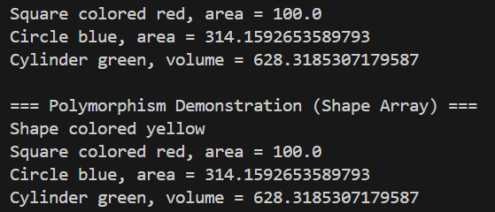

# Inheritance and Polymorphism in Java

## Project Overview
This project demonstrates the core Object-Oriented Programming (OOP) principles of **Inheritance** and **Polymorphism** using geometric shapes. It models a hierarchical relationship where specialized shapes (`Square`, `Circle`, and `Cylinder`) inherit shared properties from a base class (`Shape`), reuse code, and override methods to exhibit polymorphic behavior at runtime.

---

## Class and Method Descriptions

### 1. `Shape` (Base Class)
Represents a generic shape.
* **`Shape(String color)`**: Constructor to initialize the shape's color.
* **`getColor()`**: Returns the color of the shape.
* **`setColor(String color)`**: Updates the color of the shape.
* **`printInfo()`**: Prints the general shape information (`Shape colored [color]`).

### 2. `Square` (Subclass of `Shape`)
Represents a square geometric shape.
* **`Square(double side, String color)`**: Constructor initializing `side` and calling `super(color)`.
* **`getSide()` / `setSide(double side)`**: Getter and setter for the side length.
* **`area()`**: Computes and returns the area of the square ($side \times side$).
* **`printInfo()`**: Overrides `printInfo()` to display the square's color and area.

### 3. `Circle` (Subclass of `Shape`)
Represents a circle geometric shape.
* **`PI`**: `public static final` constant storing the value of $\pi$.
* **`Circle(double radius, String color)`**: Constructor initializing `radius` and calling `super(color)`.
* **`getRadius()` / `setRadius(double radius)`**: Getter and setter for the radius.
* **`area()`**: Computes and returns the area of the circle ($\pi \times radius^2$).
* **`printInfo()`**: Overrides `printInfo()` to display the circle's color and area.

### 4. `Cylinder` (Subclass of `Circle`)
Represents a 3D cylinder, illustrating multilevel inheritance (`Shape` $\rightarrow$ `Circle` $\rightarrow$ `Cylinder`).
* **`Cylinder(double height, double radius, String color)`**: Constructor initializing `height` and calling `super(radius, color)`.
* **`getHeight()` / `setHeight(double height)`**: Getter and setter for cylinder height.
* **`volume()`**: Computes and returns the cylinder volume by reusing the inherited circle area ($area() \times height$).
* **`printInfo()`**: Overrides `printInfo()` to display the cylinder's color and volume.

### 5. `Main`
The driver class containing the program entry point.
* **`main(String[] args)`**: Instantiates individual shape objects to verify their methods and demonstrates runtime polymorphism using a heterogeneous `Shape[]` array.

---

## Program Output

